# Basis Data FoodHub

MySQL/MariaDB (Laragon/XAMPP), 9 tabel + 1 view, relasi dengan primary key & foreign key.

| File | Isi |
|---|---|
| `foodhub.sql` | File ekspor: membuat database `foodhub`, semua tabel, view, dan data awal |
| `queries.sql` | Contoh query untuk setiap halaman |
| `migrations/001_remember_tokens.sql` | Menambahkan tabel token Ingat saya ke database lama tanpa menghapus data |

## Cara import

1. Nyalakan **MySQL** di XAMPP Control Panel.
2. Buka `http://localhost/phpmyadmin` → **Import** → pilih `foodhub.sql` → **Go**.
   Atau lewat terminal: `C:\xampp\mysql\bin\mysql -u root < foodhub.sql`

> File ini menjalankan `DROP DATABASE IF EXISTS foodhub`, jadi data lama di database `foodhub` akan terhapus saat import ulang.

## Memperbarui database yang sudah ada

Untuk fitur Ingat saya, jalankan `migrations/001_remember_tokens.sql` pada database `foodhub` yang sudah digunakan. Migrasi hanya menjalankan `CREATE TABLE IF NOT EXISTS remember_tokens`; jangan import ulang `foodhub.sql` untuk memperbarui database berisi data penting. Instalasi baru dengan `foodhub.sql` sudah mencakup tabel ini.

Token mentah hanya berada pada cookie HttpOnly. Database menyimpan selector acak dan hash SHA-256 verifier, dengan masa berlaku absolut 30 hari dalam UTC. Token dirotasi saat pemulihan login dan dicabut saat logout pada browser tersebut. Penghapusan pengguna juga menghapus tokennya melalui foreign key. Token kedaluwarsa milik pengguna dibersihkan saat penerbitan token baru; untuk pemeliharaan berkala dapat digunakan `DELETE FROM remember_tokens WHERE expires_at <= UTC_TIMESTAMP()`.

**Akun demo** (password di-hash dengan `password_hash()`):

| Email | Password | Peran |
|---|---|---|
| admin@foodhub.id | admin123 | admin |
| raka@contoh.id | rahasia123 | member |
| nadia@contoh.id | rahasia123 | member |

## Halaman yang didukung

```
Beranda
Daftar Resep
└── Detail Resep
Profil
├── Resep Favorit
└── Informasi Profil
Kelola Resep (admin)
├── Tambah Resep
├── Edit Resep
└── Hapus Resep
```

## ERD

```mermaid
erDiagram
    users ||--o{ recipes : "menambahkan (admin)"
    users ||--o{ favorites : menyimpan
    users ||--o{ reviews : menulis
    users ||--o{ remember_tokens : "login persisten"
    recipes ||--o{ recipe_categories : ""
    categories ||--o{ recipe_categories : ""
    recipes ||--o{ recipe_ingredients : berisi
    recipes ||--o{ recipe_steps : langkah
    recipes ||--o{ favorites : difavoritkan
    recipes ||--o{ reviews : diulas
```



## Daftar tabel

| Tabel | Fungsi | Halaman |
|---|---|---|
| `users` | Akun member & admin (`role`) | Masuk/Daftar, Informasi Profil |
| `remember_tokens` | Hash token login persisten dan waktu kedaluwarsa UTC | Masuk (Ingat saya), pemeriksaan sesi, logout |
| `categories` | Kategori resep | Beranda, Daftar Resep, form Tambah/Edit Resep |
| `recipes` | Data utama resep (judul, asal daerah, cerita, foto, waktu, kesulitan, porsi). `is_published` = 0 berarti disembunyikan admin | Semua halaman resep, Kelola Resep |
| `recipe_categories` | Relasi banyak-ke-banyak resep ↔ kategori | Filter kategori |
| `recipe_ingredients` | Bahan + takaran untuk porsi dasar | Detail Resep |
| `recipe_steps` | Langkah memasak berurutan | Detail Resep |
| `favorites` | Resep yang disimpan member | Detail Resep (tombol Simpan), Resep Favorit |
| `reviews` | Rating 1–5 + ulasan, maksimal 1 per member per resep | Detail Resep |
| `v_recipe_cards` (view) | Data kartu resep: rata-rata rating, jumlah ulasan & favorit, kategori | Beranda, Daftar Resep, Resep Favorit |

## Catatan desain

- **Tayang/disembunyikan**: halaman publik hanya menampilkan resep dengan `is_published = 1`.
- **Pengatur porsi**: takaran baru = `quantity × porsi_baru ÷ recipes.servings`.
- **Hapus resep**: bahan, langkah, kategori, favorit, dan ulasannya ikut terhapus otomatis (`ON DELETE CASCADE`).
- **Integritas**: email unik, slug resep unik, rating dibatasi 1–5 (`CHECK`), satu ulasan per member per resep.
- **Data awal**: 6 kategori dan 14 resep (sama dengan data di `frontend/js/main.js`), plus contoh favorit dan ulasan.
